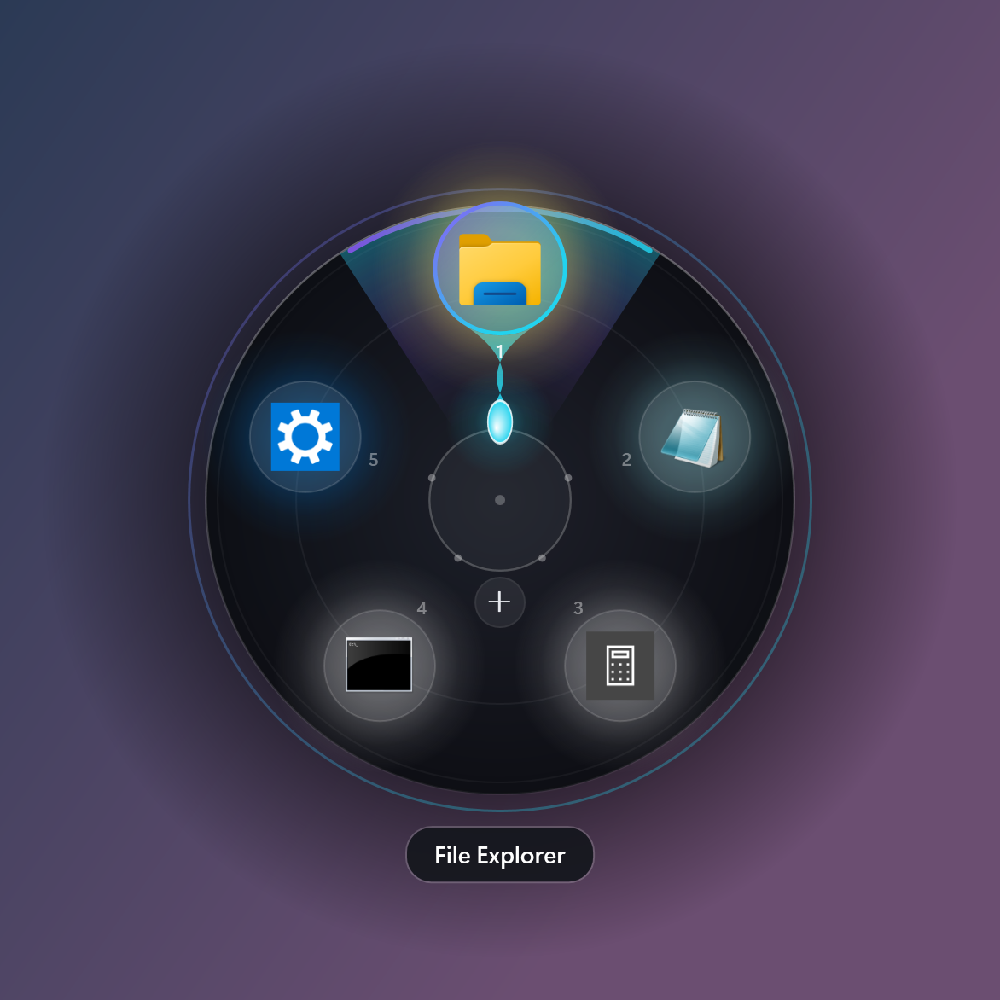
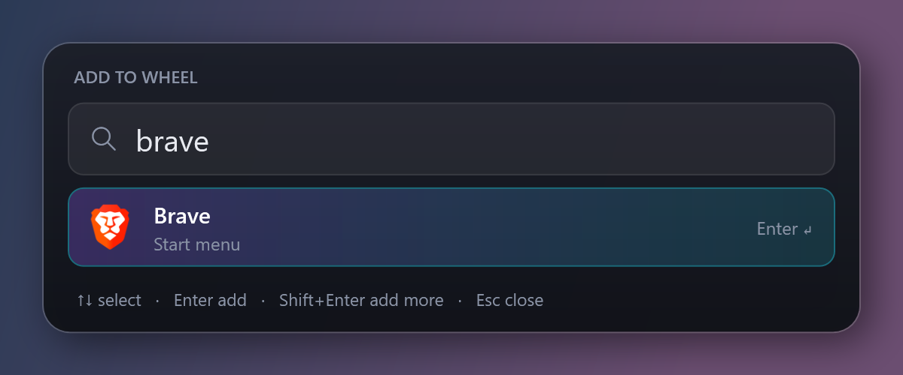

# CosmoFlick

Your apps, one flick away. A radial launcher for Windows 10 and 11.

Open the wheel at your pointer with a keyboard shortcut or a side mouse button. Aim at an app; the magnetic puck follows your direction. Flick outward or click to launch, or bring an already open app to the front.

[Website](https://cosmoflick.app) · [Releases](https://github.com/ivanmasiutin-ai/CosmoFlick-Releases/releases) · [Support](https://cosmoflick.app/#support)

## Features

- Launch apps from a wheel wherever you are working.
- Add apps with fast search, including installed Steam games.
- Use a keyboard shortcut, a side mouse button or number keys.
- Adjust the magnet, gesture distance and sound to suit your hand.
- Use the interface in English, Russian or Romanian.

| Free | Pro |
| --- | --- |
| One wheel with up to 8 shortcuts | Unlimited shortcuts |
| Magnet, flick gesture, search and sound | Actions, commands and text |
| Aurora theme | All themes, subwheels and app wheels |

Pro keeps working offline after activation. See the [website](https://cosmoflick.app/#pro) for current availability and terms.

## Install

The first GitHub installer is being prepared. There are no installer releases in this repository yet. The current portable download is available on the [website](https://cosmoflick.app/#download), where its version and unsigned status are shown.

For portable: extract the ZIP to a writable folder and run **CosmoFlick.exe**. Keep the folder when updating so your settings and shortcuts remain available.

The upcoming installer installs for your Windows account without administrator access. It can import settings and wheels from a portable folder, keeping the original files. Close CosmoFlick from the tray before installing. Uninstalling keeps your settings, wheels and Pro activation.

After starting, open CosmoFlick from the tray to configure its shortcut and mouse button. The new installer starts with an empty wheel: choose **+** to add your first app. Example shortcuts in the screenshots are not bundled.

## Dev and Stable

**Stable** is the default update channel for tested releases. **Dev** includes GitHub pre-releases for testing upcoming versions. Choose a channel in **Settings → System** in installer builds.

A Dev release is promoted to Stable only after testing. Promotion keeps the same version, tag and installer. If the package needs a fix, it gets a new version. Installer releases include `release.json` with their version, changes, SHA-256 and signing information.

## Support

Email [support@cosmoflick.app](mailto:support@cosmoflick.app) with your Windows version, CosmoFlick version, what you expected and what happened. Do not include license keys, payment details, private shortcuts or clipboard contents.

[Restore Pro](https://cosmoflick.app/restore) · [Privacy](https://cosmoflick.app/privacy) · [License terms](https://cosmoflick.app/license-terms)

This repository hosts public downloads and release information. CosmoFlick source code is maintained separately.
